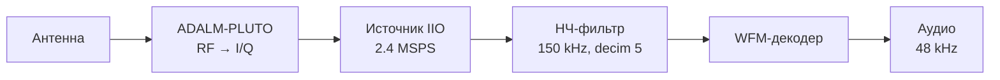
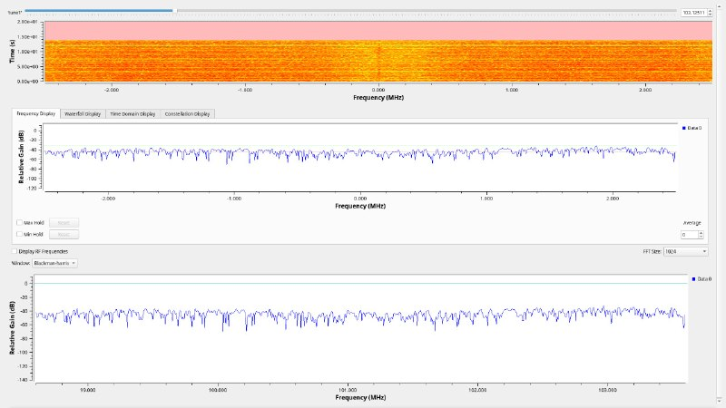
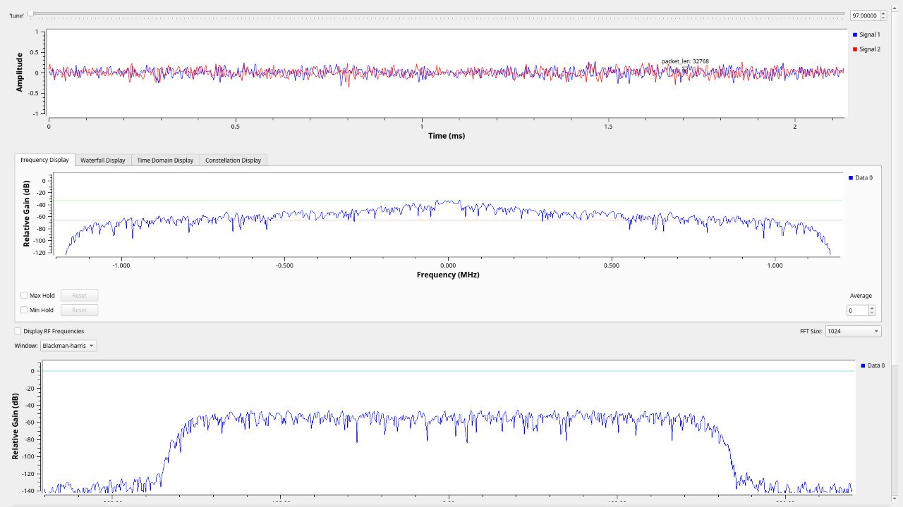
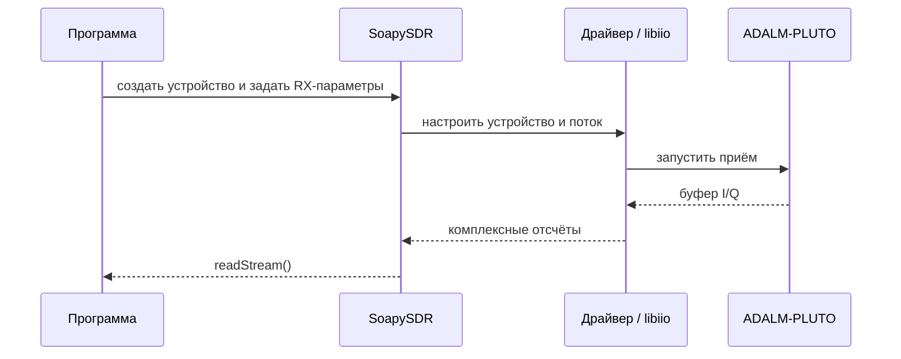
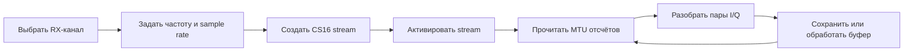
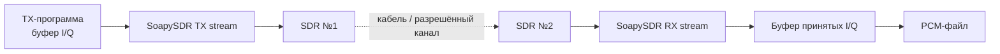
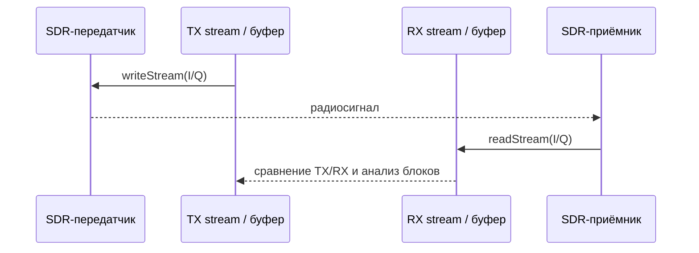

# Журнал лабораторных работ

Отчёты идут по хронологии курса: от структурной схемы радиосвязи и GNU Radio
к приёму и передаче цифровых I/Q-отсчётов с ADALM-PLUTO. Схемы ниже показывают
содержание практики; численные параметры приведены только там, где они
зафиксированы в сохранённых flowgraph-файлах или программе.

## Лабораторная 1 — 8 сентября, 13:45–17:25

**Тема:** структурная схема цифровой радиосвязи. Архитектура ADALM-PLUTO,
знакомство с GNU Radio и построение радиоприёмника.

**Задача.** Проследить путь сигнала от антенны до звука: Pluto принимает
радиосигнал, передаёт комплексные отсчёты в GNU Radio, а блоки обработки
выделяют FM-аудио.



**Схема в GNU Radio.** В `GNURadio/task1.grc` и
`GNURadio/RadioIsWorking.grc` источник Pluto выдаёт `fc32` с частотой
дискретизации 2.4 MSPS. Частота настройки меняется регулятором: в одном
flowgraph задан диапазон 95–96 МГц, в другом — 97–98 МГц. Далее поток проходит
через FIR-фильтр Кайзера с частотой среза 150 kHz и децимацией 5, затем через
`WFM Receive`. Декодированное аудио с частотой 48 kHz поступает на аудиовыход.
Точки до и после фильтра выведены на временной график и спектроанализаторы.

**Что показывает результат.** Экран GNU Radio позволяет одновременно следить
за спектром принимаемого сигнала и изменениями во времени. Это помогает
проверить, что поток с устройства поступает в граф обработки; слышимый FM-звук
является выходом демодулятора, а не исходными I/Q-отсчётами.

<p align="center">
  
</p>

**Материалы:** [`task1.grc`](GNURadio/task1.grc),
[`RadioIsWorking.grc`](GNURadio/RadioIsWorking.grc),
[`task1.py`](GNURadio/task1.py).

**Преподаватели:** Ахпашев А.В., Калачиков А.А., Попович И.А.

## Лабораторная 2 — 15 сентября, 13:45–19:00

**Тема:** структурная схема цифровой радиосвязи; приёмник и передатчик в
GNU Radio.

**Задача.** Перейти от одного направления радиотракта к двум: приёмник
получает RF-сигнал и выдаёт поток отсчётов, передатчик принимает поток
отсчётов и формирует RF-сигнал. Для двустороннего эксперимента важно
согласовать частоты настройки, sample rate и тип комплексных отсчётов.


**Разбор тракта.** Поток на передаче формируется блоками GNU Radio и подаётся
в Pluto как комплексные I/Q. На приёме выполняется обратный переход:
радиотракт устройства выдаёт цифровые I/Q в граф, где их можно наблюдать
или передавать на демодуляцию. В репозитории сохранены flowgraph-файлы
приёма, но отдельный flowgraph передатчика этой лабораторной среди
добавленных материалов не найден; схема выше показывает принцип
двунаправленной работы, а не снимок конкретного TX-графа.

**Результат.** Практика расширяет лабораторную 1 от приёма к связке
«передатчик → радиоканал → приёмник». Настройки и визуализации приёмного
графа можно посмотреть на скриншотах и в файле
[`lab2.grc`](GNURadio/lab2.grc).

<p align="center">
  
</p>

**Преподаватели:** Ахпашев А.В., Калачиков А.А., Попович И.А.

## Лабораторная 3 — 22 сентября, 13:45–19:00

**Тема:** архитектура SDR; SoapySDR, libiio и получение цифровых I/Q-отсчётов.

**Задача.** Перейти от соединения блоков в GNU Radio к управлению SDR из
программы: обнаружить Pluto, настроить направление потока, частоту и скорость
дискретизации, создать поток и прочитать буфер комплексных сэмплов.



**Работа с буфером.** I и Q — две компоненты одного комплексного отсчёта,
которые приходят попарно. Программа настраивает RX-канал, создаёт поток
формата `CS16` и читает блоки данных через `readStream`. MTU потока задаёт
размер буфера для одной операции чтения; полученные пары записываются в PCM
как `I, Q, I, Q, ...`.

Текущий пример в [`dev/main.cpp`](dev/main.cpp) показывает итоговую
инициализацию устройства и RX-путь. Он использует SoapySDR с Pluto-драйвером,
под которым работает libiio; журнал не утверждает, что на занятии уже была
реализована каждая деталь итоговой версии программы.

**Результат лабораторной:** понимание, где заканчивается RF-тракт устройства
и начинается программная обработка потока отсчётов.

**Преподаватели:** Ахпашев Р.В., Калачиков А.А., Попович И.А.

## Лабораторная 4 — 29 сентября, 13:45–19:00

**Тема:** продолжение работы с SDR API и буфером I/Q.

**Задача.** Закрепить настройку Pluto и получение буферов: устройство должно
быть настроено до старта потока, а данные — корректно интерпретированы как
комплексные отсчёты. На этом шаге внимание переносится с отдельных вызовов
API на полный цикл приёма.



**На что обратить внимание.** Ошибка в формате или размере буфера смещает
границу между I и Q и делает последующие графики бессмысленными. Для `CS16`
один комплексный отсчёт занимает два `int16_t`; количество записанных
комплексных сэмплов не следует путать с количеством отдельных чисел I и Q.
Поток после цикла чтения деактивируется и закрывается.

**Результат лабораторной:** освоен повторяемый цикл «настройка → запуск →
чтение блоков → завершение» для приёмного потока. Следующая работа использует
буферы уже с двух устройств.

**Преподаватели:** Ахпашев Р.В., Калачиков А.А., Попович И.А.

## Лабораторная 5 — 6 октября, 13:45–19:00

**Тема:** буферы I/Q и передача сэмплов между двумя SDR.

**Задача.** Сформировать сквозной тракт: считать или сформировать цифровые
сэмплы на стороне TX, передать их первым SDR, принять вторым и сохранить
результат для сравнения.



**Практический смысл буфера.** Передающий и принимающий потоки работают
пакетами: приложение передаёт блок сэмплов в TX-stream и получает блок из
RX-stream. Размер блока, формат и частота дискретизации должны совпадать
на обоих концах, иначе данные будут теряться или интерпретироваться
неправильно.

В итоговом коде репозитория эти этапы видны раздельно в `run_tx` и `run_rx`:
TX подготавливает `CS16`-буфер и отправляет его через `writeStream`;
RX принимает через `readStream`. Сохранённые `txdata.pcm` и `rxdata.pcm`
затем отображаются инструментом [`tools/plot_pcm.py`](tools/plot_pcm.py).
Это иллюстрирует результат сквозного проекта, а не отдельную запись именно
от даты занятия.

**Преподаватели:** Ахпашев Р.В., Калачиков А.А., Попович И.А.

## Лабораторная 6 — 13 октября, 13:45–19:00

**Тема:** приём и передача на двух SDR; свёртка.

**Задача.** Продолжить сквозной обмен сэмплами и связать обработку буфера
с операцией свёртки. Для дискретных последовательностей свёртка определяется
как

$$y[n] = (x * h)[n] = \sum_k x[k]h[n-k].$$

Она описывает, например, действие линейного фильтра: входная
последовательность `x` преобразуется импульсной характеристикой `h`
в выход `y`.

```mermaid
flowchart LR
    A[Принятый блок x[n]] --> C[Свёртка с h[n]]
    B[Коэффициенты h[n]] --> C
    C --> D[Результат y[n]]
    D --> E[Анализ отсчётов<br/>и формы сигнала]
```

**Связь с проектом.** Буферизация даёт конечный блок данных для обработки,
а свёртка показывает, как над такими цифровыми последовательностями
выполняется фильтрация. В сохранённом `main.cpp` представлены передача,
приём и сохранение I/Q; отдельная реализация свёртки в текущих файлах
не обнаружена, поэтому здесь зафиксирована тема занятия, а не приписан
несуществующий программный результат.

**Графики сквозного эксперимента.** На первом графике верхняя панель — TX,
нижняя — RX. В принятом потоке виден участок с более высокой амплитудой;
второй график увеличивает участок RX, чтобы рассмотреть I- и Q-компоненты
подробнее.

<p align="center">
  
</p>

<p align="center">
  
</p>

**Преподаватели:** Ахпашев Р.В., Калачиков А.А., Попович И.А.

## Лабораторная 7 — 20 октября, 13:45–19:00

**Тема:** продолжение работы с буферами и передача сэмплов между двумя SDR.

**Задача.** Повторить сквозной цикл передачи и приёма: согласовать параметры
устройств, запустить TX и RX, получить блоки отсчётов и проследить результат
по сохранённым данным и графикам.



**Итоговый график.** `Figure_1` показывает целиком записанные TX- и RX-последовательности; `Figure_2` — увеличенный фрагмент принятого сигнала.
Это визуальная проверка наличия и формы принятых отсчётов. По этим изображениям
нельзя отдельно установить параметры радиоканала или точность восстановления
переданного сигнала.

**Результат курса.** Практическая цепочка прошла путь от приёмного flowgraph
GNU Radio до настройки SDR из кода, чтения и передачи блоков CS16 и анализа
записанных I/Q-графиков.

**Преподаватели:** Ахпашев Р.В., Попович И.А.

## Материалы проекта

| Материал | Для чего нужен |
| :-- | :-- |
| [`GNURadio/`](GNURadio/) | Flowgraph-файлы ранних заданий GNU Radio и сгенерированный Python-граф. |
| [`dev/main.cpp`](dev/main.cpp) | Итоговый пример TX/RX через SoapySDR и ADALM-PLUTO. |
| [`tools/plot_pcm.py`](tools/plot_pcm.py) | Чтение PCM как пар CS16 и построение графиков I/Q. |
| [`dev/Figure_1.png`](dev/Figure_1.png), [`dev/Figure_2.png`](dev/Figure_2.png) | Общий и увеличенный графики сквозного TX/RX-эксперимента. |
