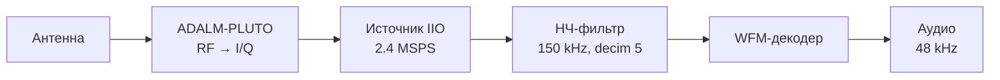
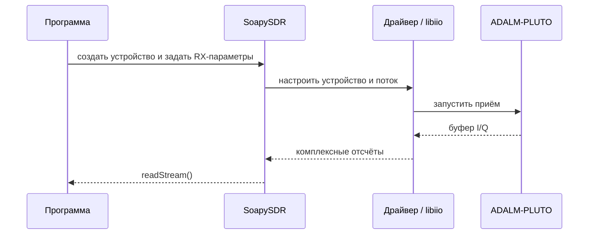
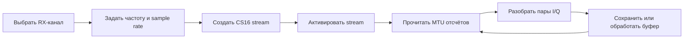
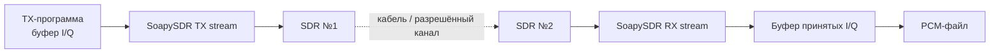
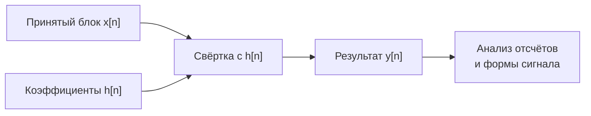
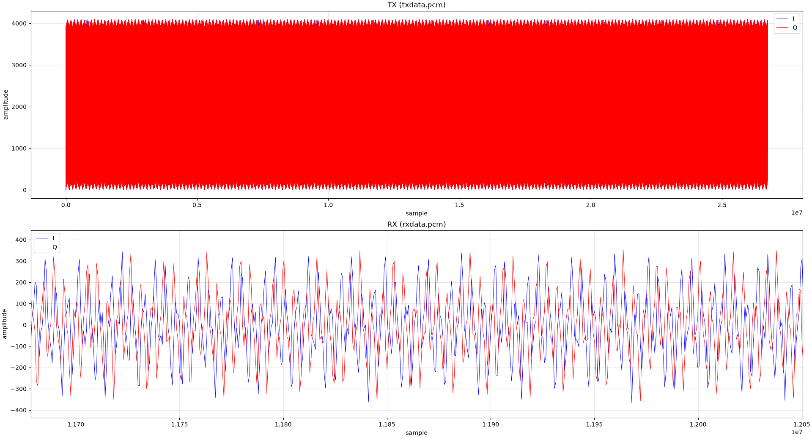
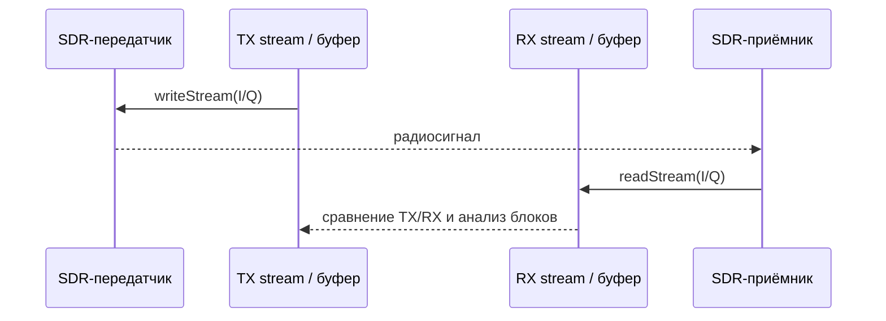

# Журнал лабораторных работ

Отчёты идут по хронологии курса: от структурной схемы радиосвязи и GNU Radio
к приёму и передаче цифровых I/Q-отсчётов с ADALM-PLUTO. Схемы ниже показывают
содержание практики; численные параметры приведены только там, где они
зафиксированы в сохранённых flowgraph-файлах или программе.

## Лабораторная 1 — 8 сентября, 13:45–17:25

**Тема:** структурная схема цифровой радиосвязи. Архитектура ADALM-PLUTO,
знакомство с GNU Radio и построение радиоприёмника.

**Задача.** Проследить путь сигнала от антенны до звука: Pluto принимает
радиосигнал, передаёт комплексные отсчёты в GNU Radio, а блоки обработки
выделяют FM-аудио.

**Схема в GNU Radio.** В `GNURadio/task1.grc` и
`GNURadio/RadioIsWorking.grc` источник Pluto выдаёт `fc32` с частотой
дискретизации 2.4 MSPS. Частота настройки меняется регулятором: в одном
flowgraph задан диапазон 95–96 МГц, в другом — 97–98 МГц. Далее поток проходит
через FIR-фильтр Кайзера с частотой среза 150 kHz и децимацией 5, затем через
`WFM Receive`. Декодированное аудио с частотой 48 kHz поступает на аудиовыход.
Точки до и после фильтра выведены на временной график и спектроанализаторы.

**Что показывает результат.** Экран GNU Radio позволяет одновременно следить
за спектром принимаемого сигнала и изменениями во времени. Это помогает
проверить, что поток с устройства поступает в граф обработки; слышимый FM-звук
является выходом демодулятора, а не исходными I/Q-отсчётами.

  

**Материалы:** [`task1.grc`](GNURadio/task1.grc),
[`RadioIsWorking.grc`](GNURadio/RadioIsWorking.grc),
[`task1.py`](GNURadio/task1.py).

**Преподаватели:** Ахпашев А.В., Калачиков А.А., Попович И.А.

## Лабораторная 2 — 15 сентября, 13:45–19:00

**Тема:** структурная схема цифровой радиосвязи; приёмник и передатчик в
GNU Radio.

**Задача.** Перейти от одного направления радиотракта к двум: приёмник
получает RF-сигнал и выдаёт поток отсчётов, передатчик принимает поток
отсчётов и формирует RF-сигнал. Для двустороннего эксперимента важно
согласовать частоты настройки, sample rate и тип комплексных отсчётов.

**Разбор тракта.** Поток на передаче формируется блоками GNU Radio и подаётся
в Pluto как комплексные I/Q. На приёме выполняется обратный переход:
радиотракт устройства выдаёт цифровые I/Q в граф, где их можно наблюдать
или передавать на демодуляцию. 
**Результат.** Практика расширяет лабораторную 1 от приёма к связке
«передатчик → радиоканал → приёмник». Настройки и визуализации приёмного
графа можно посмотреть на скриншотах и в файле
[`lab2.grc`](GNURadio/lab2.grc).

  

**Преподаватели:** Ахпашев А.В., Калачиков А.А., Попович И.А.

## Лабораторная 3 — 22 сентября, 13:45–19:00

**Тема:** архитектура SDR; SoapySDR, libiio и получение цифровых I/Q-отсчётов.

**Задача.** Перейти от соединения блоков в GNU Radio к управлению SDR из
программы: обнаружить Pluto, настроить направление потока, частоту и скорость
дискретизации, создать поток и прочитать буфер комплексных сэмплов.

**Работа с буфером.** I и Q — две компоненты одного комплексного отсчёта,
которые приходят попарно. Программа настраивает RX-канал, создаёт поток
формата `CS16` и читает блоки данных через `readStream`. MTU потока задаёт
размер буфера для одной операции чтения; полученные пары записываются в PCM
как `I, Q, I, Q, ...`.

Текущий пример в [`dev/main.cpp`](dev/main.cpp) показывает итоговую
инициализацию устройства и RX-путь. Он использует SoapySDR с Pluto-драйвером,
под которым работает libiio.

**Результат лабораторной:** понимание, где заканчивается RF-тракт устройства
и начинается программная обработка потока отсчётов.

**Преподаватели:** Ахпашев Р.В., Калачиков А.А., Попович И.А.

## Лабораторная 4 — 29 сентября, 13:45–19:00

**Тема:** продолжение работы с SDR API и буфером I/Q.

**Задача.** Закрепить настройку Pluto и получение буферов: устройство должно
быть настроено до старта потока, а данные — корректно интерпретированы как
комплексные отсчёты. На этом шаге внимание переносится с отдельных вызовов
API на полный цикл приёма.

**Результат лабораторной:** освоен повторяемый цикл «настройка → запуск →
чтение блоков → завершение» для приёмного потока. Следующая работа использует
буферы уже с двух устройств.

**Преподаватели:** Ахпашев Р.В., Калачиков А.А., Попович И.А.

## Лабораторная 5 — 6 октября, 13:45–19:00

**Тема:** буферы I/Q и передача сэмплов между двумя SDR.

**Задача.** Сформировать сквозной тракт: считать или сформировать цифровые
сэмплы на стороне TX, передать их первым SDR, принять вторым и сохранить
результат для сравнения.

**Практический смысл буфера.** Передающий и принимающий потоки работают
пакетами: приложение передаёт блок сэмплов в TX-stream и получает блок из
RX-stream. Размер блока, формат и частота дискретизации должны совпадать
на обоих концах, иначе данные будут теряться или интерпретироваться
неправильно.

В итоговом коде репозитория эти этапы видны раздельно в `run_tx` и `run_rx`:
TX подготавливает `CS16`-буфер и отправляет его через `writeStream`;
RX принимает через `readStream`. Сохранённые `txdata.pcm` и `rxdata.pcm`
затем отображаются инструментом [`tools/plot_pcm.py`](tools/plot_pcm.py).

**Преподаватели:** Ахпашев Р.В., Калачиков А.А., Попович И.А.

## Лабораторная 6 — 13 октября, 13:45–19:00

**Тема:** приём и передача на двух SDR; свёртка.

**Задача.** Продолжить сквозной обмен сэмплами и связать обработку буфера
с операцией свёртки. Для дискретных последовательностей свёртка определяется
как

$$y[n] = (x * h)[n] = \sum_k x[k]h[n-k].$$

Она описывает, например, действие линейного фильтра: входная
последовательность `x` преобразуется импульсной характеристикой `h`
в выход `y`.

**Связь с проектом.** Буферизация даёт конечный блок данных для обработки,
а свёртка показывает, как над такими цифровыми последовательностями
выполняется фильтрация. В сохранённом `main.cpp` представлены передача,
приём и сохранение I/Q; 
**Графики сквозного эксперимента.** На первом графике верхняя панель — TX,
нижняя — RX. В принятом потоке виден участок с более высокой амплитудой;
второй график увеличивает участок RX, чтобы рассмотреть I- и Q-компоненты
подробнее.

  

  

**Преподаватели:** Ахпашев Р.В., Калачиков А.А., Попович И.А.

## Лабораторная 7 — 20 октября, 13:45–19:00

**Тема:** продолжение работы с буферами и передача сэмплов между двумя SDR.

**Задача.** Повторить сквозной цикл передачи и приёма: согласовать параметры
устройств, запустить TX и RX, получить блоки отсчётов и проследить результат
по сохранённым данным и графикам.

**Итоговый график.** `Figure_1` показывает целиком записанные TX- и RX-последовательности; `Figure_2` — увеличенный фрагмент принятого сигнала.
Это визуальная проверка наличия и формы принятых отсчётов. 
**Результат курса.** Практическая цепочка прошла путь от приёмного flowgraph
GNU Radio до настройки SDR из кода, чтения и передачи блоков CS16 и анализа
записанных I/Q-графиков.

**Преподаватели:** Ахпашев Р.В., Попович И.А.

## Лабораторная 8 — 27 октября, 13:45–19:00

**Тема:** передатчик цифрового радиоканала: модуляция, апсемплинг, свёртка (формирующий фильтр), сквозной тракт TX/RX и согласованная фильтрация.

**Задача.** Собрать программный передатчик с нуля без готовых высокоуровневых DSP-библиотек:
1. Реализовать генератор битового потока (псевдослучайный и строковый).
2. Реализовать модуляторы BPSK и QPSK с получением комплексных отсчётов $I/Q$.
3. Добавить апсемплинг (интерполяцию нулями с фактором 10) для согласования символьной скорости с дискретизацией радиотракта.
4. Выполнить свёртку с прямоугольной импульсной характеристикой длины 10 для формирования прямоугольных радиоимпульсов.
5. Организовать пакетную передачу через ADALM-PLUTO на несущей 800 МГц (1 MSps) с таймстемпами и буферами тишины.
6. Принять эфирный сигнал вторым SDR и применить согласованный фильтр.

```mermaid
flowchart LR
    A["Биты<br/>string_to_bits"] --> B["QPSK модулятор<br/>I/Q = ±0.707"]
    B --> C["Upsampling ×10<br/>вставка нулей"]
    C --> D["Свёртка с h[n]<br/>прямоугольный импульс"]
    D --> E["Кадр с преамбулой<br/>и таймстемпом"]
    E --> F["ADALM-PLUTO TX<br/>800 МГц, 1 MSps"]
    F -. эфир .-> G["ADALM-PLUTO RX<br/>800 МГц, 1 MSps"]
    G --> H["Согласованный фильтр<br/>свёртка с нормировкой"]
    H --> I["rxdata.pcm<br/>I/Q + созвездие"]
```

**Реализация передатчика:**
1. **Генерация бит:** функция `generate_bits(size)` формирует поток случайных бит на базе `std::bernoulli_distribution(0.5)`, а `string_to_bits(str)` разбирает байты строки на биты старшими разрядами вперёд (`"SIBGUTI_IKS431"` — 14 байт, 112 бит).
2. **Модуляция:**
   - `bpsk()` отображает бит 1 в $+1.0$, бит 0 в $-1.0$.
   - `qpsk()` группирует биты по парам $(b_{2k}, b_{2k+1})$, задавая синфазную и квадратурную составляющие с нормировкой $1/\sqrt{2} \approx 0.7071$:
     $$I = \pm \frac{1}{\sqrt{2}}, \quad Q = \pm \frac{1}{\sqrt{2}}.$$
     Каждая пара формирует комплексный символ созвездия QPSK.
3. **Апсемплинг:** функция `upsample(symbols, factor)` вставляет между информационными символами по $factor - 1$ нулевых отсчётов. При коэффициенте 10 и частоте дискретизации 1 MSps символьная скорость передачи составляет 100 кбод (10 сэмплов на символ).
4. **Свёртка:** функция `convolution(samples, h_size, scale)` вычисляет дискретную свёртку:
     $$y[n] = (x * h)[n] = \sum_k x[k] h[n - k].$$
   На передаче в качестве $h[n]$ используется прямоугольное окно из 10 единиц (`h_size = 10`, `scale = 1.0f`). В результате свёртки с дельта-импульсами получается ступенчатая форма импульсов длительностью ровно 10 сэмплов на символ.

  

5. **Пакетная передача (TX):**
   - Сигнал масштабируется коэффициентом `TX_AMPLITUDE = 2000.0f` (отсчёты около $\pm 1414$).
   - В активном буфере формируются 3 информационных блока: преамбула `0xFFFF`, 8 байт аппаратного таймстемпа `tx_time`, закрывающий маркер `0xFFFF` и отсчёты модулированного сигнала (569 сэмплов).
   - За активным буфером по аппаратному таймеру SoapySDR отправляется нулевой буфер тишины для разделения пачек во времени и исключения перегрузки ЦАП.

6. **Приём и согласованная фильтрация (RX):**
   - Поток читается блоками через `readStream` в формате `CS16`.
   - Принятые отсчёты пропускаются через согласованный фильтр `convolution(rx_samples, 10, 0.1f)` (прямоугольное окно длины 10 с нормировкой $1/10$). Фильтр сглаживает шум дискретизации и максимизирует отношение сигнал/шум в моменты стробирования.

  

**Анализ работы: что получилось, а что нет:**
* **Что получилось:**
  - Написан рабочий передатчик на C++ с нуля: генерация бит, модуляция в QPSK, растягивание нулями и формирование прямоугольных импульсов через свёртку.
  - Сигнал успешно передан через ADALM-PLUTO на частоте 800 МГц и пойман вторым приёмником (записаны `txdata.pcm` и `rxdata.pcm`).
  - На передаче созвездие идеальное — чёткие 4 точки в вершинах квадрата.
  - Согласованный фильтр на приёме успешно сглаживает шум эфира и формирует отклики импульсов.
* **Что не получилось и над чем предстоит работать:**
  - **Созвездие на приёме крутится и смазывается в круг:** вместо четырёх фиксированных точек получается кольцо («бублик»). Это происходит из-за того, что реальные частоты генераторов двух плат слегка различаются (есть сдвиг частоты). Из-за этого фаза сигнала непрерывно вращается.
  - **Символы не попадают в середину отсчёта:** из-за задержки сигнала в радиоканале приёмник берёт отсчёты со смещением во времени относительно переданных импульсов.
  - **Нельзя сразу восстановить биты:** без подстройки частоты и точного выбора момента стробирования каждого символа демодулятор выдаёт ошибки. Этим предстоит заняться на занятиях по приёмнику (синхронизация частоты и времени).

**Преподаватели:** Калачиков А.А., Ахпашев Р.В., Попович И.А.

## Материалы проекта

| Материал | Для чего нужен |
| :-- | :-- |
| [`GNURadio/`](GNURadio/) | Flowgraph-файлы ранних заданий GNU Radio и сгенерированный Python-граф. |
| [`dev/main.cpp`](dev/main.cpp) | Итоговый пример сквозного TX/RX через SoapySDR и ADALM-PLUTO. |
| [`dev/transmitter.cpp`](dev/transmitter.cpp) | Прототип генератора бит, модуляторов BPSK/QPSK, апсемплинга и свёртки. |
| [`tools/plot_pcm.py`](tools/plot_pcm.py) | Чтение PCM CS16, построение временных графиков и диаграмм созвездий (I/Q scatter). |
| [`dev/Figure_1.png`](dev/Figure_1.png), [`dev/Figure_2.png`](dev/Figure_2.png) | Общий и увеличенный графики сквозного TX/RX-эксперимента (лабораторные 6–7). |
| [`dev/Figure_lab8_tx_shaping.png`](dev/Figure_lab8_tx_shaping.png) | Формирование импульсов на TX: апсемплинг и свёртка с прямоугольным окном (лабораторная 8). |
| [`dev/Figure_lab8_constellation.png`](dev/Figure_lab8_constellation.png) | Временные отсчёты и созвездия TX и RX с эффектом вращения фазы от CFO (лабораторная 8). |
| [`pcms/backup_clean_20261110/README.md`](pcms/backup_clean_20261110/README.md) | Описание параметров радиотракта, контрольные суммы и структура эталонных дампов. |
