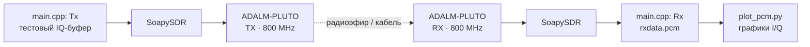
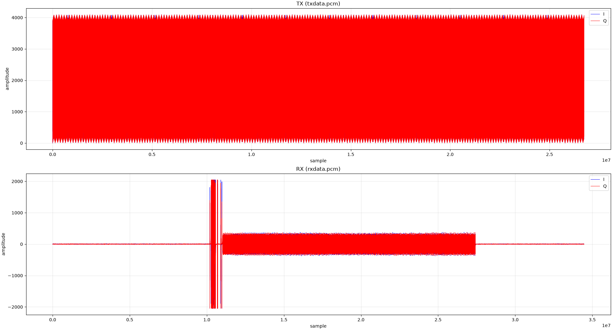
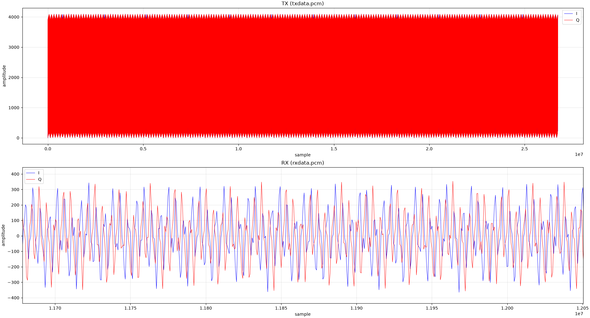

<p align="center">
  
</p>

<p align="center">
  <a href="#быстрый-старт"></a>
  <a href="#что-используется"></a>
  <a href="#что-используется"></a>
  
</p>

> Небольшой учебный проект по программно-определяемому радио. Здесь я разбираюсь, как через **SoapySDR** управлять ADALM-PLUTO, передавать IQ-отсчёты и сохранять принятый сигнал для дальнейшего просмотра.

## Что умеет проект

| Часть                              | Что делает                                                                                  |
|:---------------------------------- |:------------------------------------------------------------------------------------------- |
| [`main.cpp`](dev/main.cpp)         | Единая программа: передаёт тестовый I/Q-сигнал или принимает поток, в зависимости от флага. |
| [`plot_pcm.py`](tools/plot_pcm.py) | Строит графики I и Q из записанных PCM-файлов.                                              |

Параметры эксперимента: пресеты **800 и 900 МГц**, **1 MSPS**, один канал и формат `CS16` (`I, Q, I, Q, ...`).

## Быстрый старт

### Что нужно установить

- CMake 3.16+ и компилятор с поддержкой C++;
- [SoapySDR](https://github.com/pothosware/SoapySDR);
- драйвер SoapySDR для PlutoSDR / libiio;
- ADALM-PLUTO, подключённый по USB;
- для графиков: Python 3, `numpy` и `matplotlib`.

Проверить, что устройство видно через SoapySDR, можно так:

```bash
SoapySDRUtil --find
```

В выводе ожидается устройство с драйвером `plutosdr`.

### Сборка

```bash
cmake -S dev -B build
cmake --build build
```

После сборки появится единая программа `build/sdr`.

### Запуск эксперимента

В двух терминалах запустите приёмник и передатчик:

```bash
# Терминал 1: приём на 800 МГц
./build/sdr Rx --freq 1

# Терминал 2: передача на той же частоте
./build/sdr Tx --freq 1
```

Поддерживаются также флаги `--rx` и `--tx`. `--freq 1` выбирает 800 МГц, `--freq 2` — 900 МГц. Режимы создают IQ-дампы `rxdata.pcm` и `txdata.pcm` в текущей директории. Их можно посмотреть так:

```bash
python3 tools/plot_pcm.py
```

> [!WARNING]
> Передача в радиоэфир регулируется законодательством. Для первых опытов лучше использовать эквивалент нагрузки, экранированное соединение или разрешённый диапазон. Частоту, мощность и усиление обязательно проверяйте перед запуском.

## Как устроен эксперимент



В передатчике создаётся треугольный тестовый сигнал, где I и Q имеют одинаковое значение. Для записи на передачу используются метки времени: пакет планируется немного «вперёд» относительно аппаратного времени SDR. Это помогает не отправить его слишком поздно.

## Результаты

На графике ниже сверху показан подготовленный TX-буфер, снизу — сигнал, записанный на приёме. В видимом участке RX заметен приход тестового сигнала.

<p align="center">
  
</p>

На втором графике показан увеличенный участок принятого I/Q-сигнала.

<p align="center">
  
</p>

## Структура

```text
.
├── assets/             # SVG для оформления репозитория
├── dev/
│   ├── CMakeLists.txt  # цель sdr
│   └── main.cpp        # TX/RX, выбор частоты через аргументы
└── tools/
    └── plot_pcm.py     # визуализация IQ-дампов
```

## 

## Полезные заметки

- Файлы `.pcm` содержат пары 16-битных знаковых значений: сначала I, затем Q.
- Параметр `uri` использует `ip:192.168.2.1`: это сетевой интерфейс, который Pluto создаёт через тот же USB-кабель. Такой способ не конфликтует с захватом raw-USB интерфейса другими IIO-клиентами.
- Папка сборки и большие IQ-дампы не должны попадать в коммиты — это уже учтено в [`.gitignore`](.gitignore).

---

<p align="center">
  Сделано в учебных целях · <a href="https://github.com/pothosware/SoapySDR">SoapySDR</a> · ADALM-PLUTO
</p>
